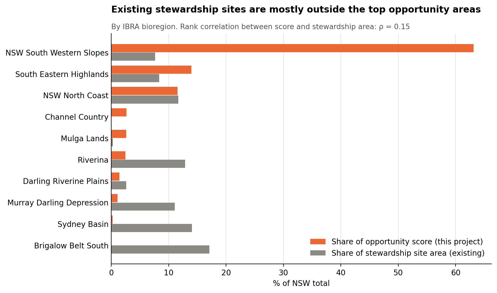

# NSW Biodiversity Credit Opportunity Map

[](https://github.com/Likithaa07/nsw-credit-opportunity-map/actions/workflows/tests.yml)

**Where does native vegetation remain for the NSW biodiversity credit types that have run out?**

This project maps the remaining native vegetation for six ecosystem credit types that have **zero
credits available** on the NSW Biodiversity Offsets Scheme (BOS) register but are still in demand. It
then ranks IBRA subregions as **areas for further investigation** for new Biodiversity Stewardship
Agreements.

**[Briefing note (PDF)](outputs/reports/Briefing_Note.pdf)** ·
**[Overview map](outputs/maps/01_statewide_overview.png)** ·
**[Metadata (ANZLIC)](outputs/reports/Metadata_ANZLIC.pdf)** ·
**[Decisions log](outputs/reports/Decisions_Log.pdf)**

| 6 | 105,009 | 860,669 ha | 132 | 1,018 | 5 |
|:---:|:---:|:---:|:---:|:---:|:---:|
| under-supplied credit types | vegetation polygons analysed | remnant vegetation mapped | IBRA subregions ranked | protected areas overlaid | maps produced |

---

## Why this matters

- **Credit shortages are widespread.** The NSW Biodiversity Offsets Scheme requires developers to
  offset the vegetation they clear with credits for the **same vegetation type**. But many types have
  run out:
  - the NSW Audit Office (2022) found 91% of ecosystem credit demand could not be matched to supply;
  - IPART (2026) reports that about 40% of biodiversity types face offsetting difficulties.
- **New supply needs the right land.** It can only come from landholders who still have that
  vegetation on their land.
- **This project shows where that vegetation is**, so outreach for new stewardship sites can start in
  the right places.

## Key findings

| Rank | IBRA subregion | Why it stands out |
|---:|---|---|
| 1 | **Inland Slopes** (NSW South Western Slopes) | Holds almost all remaining PCT 290 and 99% of PCT 309, the two most-demanded types |
| 2 | **Macleay Hastings** (NSW North Coast) | Largest unprotected area of Northern Swamp Mahogany–Bottlebrush Swamp Forest (PCT 4047) |
| 3 | **Hill End** (South Eastern Highlands) | Largest area of PCT 3406, which is 89% cleared and almost entirely unprotected |
| 4 | **Orange** (South Eastern Highlands) | Second-largest area of PCT 3406 |
| 5 | **Karuah Manning** (NSW North Coast) | Second-largest area of PCT 4047 |

- **Southwest Ranges White Box Woodland (PCT 3406)** is the standout case:
  - 89% cleared.
  - Only **0.6%** of its 14,988 remaining hectares is protected.
  - 83% of it lies in Hill End and Orange.
- **Supply is concentrated.** The two most-demanded types (507 and 289 credits retired a year)
  survive almost only in Inland Slopes.
- **The ranking is robust.** The top five are unchanged under four different weightings.
- **Biodiversity value is high.** Each top subregion has 66–211 threatened species recorded in BioNet.
- **The top area is under-served by existing stewardship sites.** The NSW South Western Slopes
  holds 63% of the opportunity score but only 8% of the area under the 380 Biodiversity
  Stewardship Agreements in force. Existing sites are mostly elsewhere: there is no meaningful
  link between the score and stewardship area by bioregion (Spearman ρ = 0.15, p = 0.55).
  [Details](#reality-check-existing-stewardship-sites)

| PCT | Credit type | Remaining | Protected | % cleared | Retired/yr |
|---|---|---:|---:|---:|---:|
| 309 | Black Cypress Pine – Red Stringybark low open forest | 7,424 ha | 39% | 15% | 507 |
| 290 | Red Stringybark – Red Box – Long-leaved Box low open forest | 42,852 ha | 23% | 67% | 289 |
| 24 | Canegrass swamp tall grassland wetland | 790,654 ha | 10% | 20% | 155 |
| 4047 | Northern Swamp Mahogany–Bottlebrush Swamp Forest | 4,746 ha | 45% | 33% | 153 |
| 1604 | Narrow-leaved Ironbark – Grey Box – Spotted Gum woodland | 5 ha | 0% | 71% | 137 |
| 3406 | Southwest Ranges White Box Woodland | 14,988 ha | 0.6% | 89% | 127 |

## Map series

| Map | Shows |
|---|---|
| [01 Statewide overview](outputs/maps/01_statewide_overview.png) | Subregions shaded by opportunity score; top five labelled |
| [02 PCT 309](outputs/maps/02_pct_309.png) | Black Cypress Pine – Red Stringybark |
| [03 PCT 290](outputs/maps/03_pct_290.png) | Red Stringybark – Red Box – Long-leaved Box |
| [04 PCT 3406](outputs/maps/04_pct_3406.png) | Southwest Ranges White Box Woodland |
| [05 PCT 4047](outputs/maps/05_pct_4047.png) | Northern Swamp Mahogany–Bottlebrush Swamp Forest |

## Technical highlights

- **API-driven, reproducible pipeline.** Every input comes straight from official services:
  - BioNet OData for vegetation IDs and % cleared;
  - the SVTM ArcGIS service for the polygons;
  - DCCEEW downloads for IBRA and CAPAD.

  One command (`python src/run_all.py`) rebuilds everything.
- **Worked around a 12.5 GB download.** The full vegetation map is behind bot protection, so the
  pipeline pages through the map service and fetches only the six target vegetation types.
- **Verified at every step.**
  - Downloaded hectares match the service's own statistics exactly.
  - The re-run ranking reproduces the original results exactly.
- **Faster overlay.** Replacing a dissolve with a spatial-index intersection cut the protected-area
  step from 30+ minutes to about 5 seconds, without double counting overlapping reserves.
- **Tested, not assumed.** The ranking was re-run under four weightings, and the top five held.
- **Data conflicts caught and documented.** The 1750 vegetation map disagreed sharply with BioNet's
  official % cleared, so the official figures were used and the conflict was recorded
  (`extent_check.csv`).
- **Responsible with sensitive data.** Threatened species are reported only as counts per subregion,
  following the BioNet Sensitive Species Data Policy.
- **Documented like a government dataset.** It comes with an ANZLIC-profile metadata record, a
  decisions log and a two-page briefing note.

## Data

| Dataset | Custodian | Used for |
|---|---|---|
| [State Vegetation Type Map](https://datasets.seed.nsw.gov.au/dataset/nsw-state-vegetation-type-map) C2.0M2.2 (extant and 1750) | NSW DCCEEW | Where each target PCT is mapped (queried from the [ArcGIS service](https://mapprod3.environment.nsw.gov.au/arcgis/rest/services/VIS/SVTM_NSW_Extant_PCT/MapServer)) |
| [BioNet Vegetation Classification](https://www.environment.nsw.gov.au/topics/animals-and-plants/biodiversity/nsw-bionet/nsw-plant-community-type-classification) | NSW DCCEEW | PCT IDs, status (current or retired) and official % cleared |
| BioNet Species Sightings ([OData API](https://data.bionet.nsw.gov.au/biosvcapp/odata/)) | NSW DCCEEW | Threatened species counts per subregion (context only) |
| [IBRA v7.1 subregions](https://fed.dcceew.gov.au/datasets/erin::interim-biogeographic-regionalisation-for-australia-ibra-version-7-subregions) | Australian Government DCCEEW | Ranking units |
| [CAPAD 2024 terrestrial](https://data.gov.au/data/dataset/erin-collaborative-australian-protected-areas-database-capad-2024-terrestrial-) | Australian Government DCCEEW | Protected areas (1,018 in NSW) |
| BOS registers | NSW DCCEEW | Target credit types and demand (credits retired per year) |
| [Public register of conservation agreements](https://www.nsw.gov.au/environment-land-and-water/conservation-on-private-land/public-register) (Q1 FY27) | Biodiversity Conservation Trust | Bioregion and area of each Biodiversity Stewardship Agreement (reality check) |

### How the data was sourced

- **The vegetation map.** The full SVTM download is 12.5 GB and sits behind bot protection that
  blocks scripted downloads. Instead, `download_layers.py` queries the official **ArcGIS map
  service**, 1,000 polygons at a time, for just the six target PCTs (105,009 polygons).
  - The totals match the service's own statistics exactly.
- **PCT IDs and % cleared** come straight from the **BioNet OData API**, so the pipeline always uses
  the current classification.

### Data files

| File | What it is |
|---|---|
| `data/processed/pct_targets.csv` | The six target PCTs: status, % cleared, BioNet extent |
| `data/processed/ibra_nsw.gpkg` | 132 NSW IBRA subregions (EPSG:3308) |
| `data/processed/remnant_by_subregion.csv` | Remaining, protected and unprotected hectares per PCT and subregion |
| `data/processed/subregion_ranking.csv` | **Main result.** Score and rank for each subregion |
| `data/processed/sensitivity_test.csv` | Top five under four weightings |
| `data/processed/threatened_species_top5.csv` | Threatened species counts for the top five subregions (no locations) |
| `data/processed/extent_check.csv` | Mapped extent vs BioNet figures (why BioNet % cleared is used) |
| `data/processed/stewardship_by_bioregion.csv` | Opportunity score vs existing stewardship sites, by bioregion |

The large spatial files (`svtm_targets.gpkg`, `pieces.gpkg`, `capad.zip`) are **not committed**
because they are over GitHub's size limit. Running the pipeline re-creates them.

## Data source and licence

Source data © State of New South Wales (DCCEEW) and © Commonwealth of Australia (DCCEEW), licensed
under Creative Commons Attribution. The derived outputs in this repository are released under
[CC BY 4.0](https://creativecommons.org/licenses/by/4.0/). Species data is reported only as counts by
subregion, in line with the
[BioNet Sensitive Species Data Policy](https://www.environment.nsw.gov.au/topics/animals-and-plants/wildlife-management/wildlife-policies-and-guidelines/sensitive-species-data-policy-wildlife-management).

## Installation

Requirements: Python 3.12 or later. Package versions are pinned in `requirements.txt`.

```bash
git clone https://github.com/Likithaa07/nsw-credit-opportunity-map.git
cd nsw-credit-opportunity-map
pip install -r requirements.txt
```

It also runs in Google Colab, where geopandas is pre-installed.

## How to run it

From the repository folder:

```bash
python src/run_all.py
```

It runs the steps below in order and stops with a clear message if an input is missing,
a data service fails, or the data fails a check. Web requests are retried up to five times
(waiting 2, 4, 8, 16 and 32 seconds), error pages are never treated as data, and a failed
download never leaves a half-written file behind.

To run only some steps, for example to redo the ranking and maps after changing the score:

```bash
python src/run_all.py --only rank maps
```

Or run a step on its own (`python src/rank_subregions.py`):

| Order | Script | What it does | Time |
|---:|---|---|---|
| 1 | `get_targets.py` | Looks up the target PCTs in BioNet and warns if any are retired | seconds |
| 2 | `download_layers.py` | Downloads IBRA, CAPAD and the target PCT polygons (skips files it already has) | 15–30 min |
| 3 | `overlay.py` | Splits vegetation by subregion and measures protected area | about 5 min |
| 4 | `rank_subregions.py` | Scores, ranks and runs the sensitivity test | seconds |
| 5 | `species_context.py` | Counts threatened species in the top five subregions | a few minutes |
| 6 | `make_maps.py` | Draws the five maps | about 1 min |
| 7 | `stewardship_check.py` | Compares the ranking with existing stewardship sites (needs the register CSV in `data/raw/`, see below) | seconds |

Step 7 is skipped with a warning if the register CSV has not been downloaded.

To change the target credit types, edit `DEMAND` in `src/config.py`.

**Or with Docker** (no Python setup needed):

```bash
docker build -t credit-map .
docker run --rm -v "$PWD/data:/app/data" -v "$PWD/outputs:/app/outputs" credit-map
```

### Tests

```bash
python -m pytest -v
```

The 20 tests check:

- the area maths on squares with known areas, including that overlapping reserves are never
  counted twice
- the retries and error handling, using a small local web server that fails on purpose
- that the ranking and sensitivity test rebuilt from the committed tables match the published
  results exactly, along with the headline figures (860,669 ha; Hill End and Orange holding 83%
  of PCT 3406)
- the stewardship check, on a small made-up register

GitHub Actions runs the tests on every push, then rebuilds the ranking and confirms nothing
changed (`.github/workflows/tests.yml`).

## Method

1. **Targets.** From the BOS public registers (credit supply and transactions, October 2026), I
   selected the ecosystem credit types with **zero credits available** that are still being retired,
   ranked them by credits retired per year, and looked up their PCT IDs in BioNet.
2. **Remaining extent.** The target PCT polygons from the SVTM were intersected with IBRA v7.1
   subregions in NSW Lambert (EPSG:3308).
3. **Protection.** Overlap with CAPAD 2024 protected areas was measured using a spatial index.
   - Each piece's protected area is capped at its own area, so overlapping reserves are never counted
     twice.
4. **Score.** For each PCT in each subregion:

   > share of that PCT's unprotected remnant × credits retired per year × (1 + BioNet % cleared)

   - The subregion score is the sum across PCTs. In plain words, it estimates how much unmet demand
     a subregion could help supply, weighted towards the most threatened types.
   - Remnants under 10 ha are ignored.
5. **Sensitivity.** The ranking was re-run without threat, without demand and with equal weights.
   The top five did not change.
6. **Context.** BioNet threatened species counts were added for the top five subregions. They are not
   part of the score, because record counts reflect survey effort.

The scoring follows the logic of systematic conservation planning (Margules & Pressey, 2000). It is
also close to the approach of the
[Biodiversity Conservation Investment Strategy 2018](https://www.environment.nsw.gov.au/publications/biodiversity-conservation-investment-strategy-2018),
which ranked IBRA subregions by % cleared, connectivity and threat.

## Reality check: existing stewardship sites

Is the market already supplying credits where the ranking points? The Biodiversity Conservation
Trust's public register lists every Biodiversity Stewardship Agreement (BSA) with its IBRA
bioregion and area. Agreement boundaries are internal-use only, so the check is made by bioregion.
`stewardship_check.py` compares each bioregion's share of the opportunity score with its share of
BSA area (380 agreements in force, 129,662 ha).

| Bioregion | Share of opportunity score | Share of BSA area | BSAs in force |
|---|---:|---:|---:|
| NSW South Western Slopes | **63%** | **8%** | 23 |
| South Eastern Highlands | 14% | 8% | 38 |
| NSW North Coast | 12% | 12% | 55 |
| Sydney Basin | 0.2% | 14% | 168 |
| Brigalow Belt South | 0.0% | 17% | 36 |

- The bioregion with almost two-thirds of the opportunity has less than a tenth of the existing
  stewardship area, so the top-ranked areas are **untapped**, not already supplied.
- Existing sites are concentrated in the Sydney Basin, Brigalow Belt South and Riverina, where
  the six target credit types barely occur.
- There is no meaningful rank correlation between score and BSA area (Spearman ρ = 0.15,
  p = 0.55, 18 bioregions).



Caveats: bioregions are much coarser than the subregions used in the ranking, and BSA area covers
all credit types, not only the six targets. To re-run it, download the register CSV from the link
above and save it as `data/raw/bct_public_register.csv`.

## Limitations

- **Vegetation map accuracy.**
  - SVTM accuracy at PCT level is 57–76% by region (2022 technical notes). No figure is published for
    C2.0M2.2.
  - A field check in the Upper Hunter found only 17% of PCT labels were correct (Hunter, 2016).
  - The map is regional scale (1:25,000 at best). **Every area needs field validation.**
- **Map vs official figures.** The mapped pre-clearing (1750) extent shows very little clearing for
  most targets, which conflicts with BioNet. For example, PCT 290 shows 94% remaining on the map but is
  67% cleared in BioNet. BioNet's official figures were used (see `extent_check.csv`).
- **Reclassified vegetation.** PCT 1600 was retired in 2022, and PCT 1604 maps to only 5 ha, because
  the 2022 revision re-labelled most of it. There is no public old-to-new lookup.
- **Clearing data is dated.** The SVTM extent reflects clearing to 2021, and clearing has continued
  (66,498 ha in 2023, SLATS).
- **Remnant is not supply.**
  - Tenure, condition, landholder willingness and existing agreements are unknown.
  - The Biodiversity Conservation Trust (BCT) agreements layer is internal-use only, so existing
    stewardship sites could not be removed from the remnant. They are compared by bioregion
    instead (see the reality check above).
- **Demand is a lower bound.** Demand comes from retirements, which miss unmet
  obligations.
- **Sensitive species.** Only subregion-level counts are used. Locations of sensitive species are
  generalised or withheld by BioNet.

## What's in this repository

### Folders at a glance

```
├── analysis.ipynb      the original Colab notebook, step by step
├── src/                re-runnable Python scripts (the notebook, cleaned up)
├── tests/              pytest tests
├── .github/workflows/  runs the tests on every push
├── data/processed/     result tables and the NSW subregion boundaries
├── outputs/maps/       the five maps
├── outputs/reports/    briefing note, metadata and decisions log as PDFs
├── docs/               the same documents as editable Markdown
├── metadata/           ANZLIC-profile metadata record (Markdown)
├── README.md           this page
├── requirements.txt    Python packages needed (exact versions)
└── Dockerfile          runs the pipeline in a container
```

### Every file explained

**`analysis.ipynb`** is the working notebook from Google Colab, where the analysis was first built.
It shows each step as it was run, including the slower first
attempts at the protected-area overlay that led to decision 5 in the decisions log.

**`src/`** holds the same analysis as clean scripts, so anyone can re-run it from scratch.

| Script | What it does | Reads | Writes |
|---|---|---|---|
| `utils.py` | Shared helpers: logging, clear error messages, input checks, and web requests that retry | | |
| `config.py` | Shared settings: target PCTs and their demand, service URLs, projection, colours | | |
| `get_targets.py` | Looks up each target PCT in the BioNet Vegetation Classification; warns if any are retired | BioNet API | `pct_targets.csv` |
| `download_layers.py` | Downloads IBRA subregions (clipped to NSW), CAPAD protected areas and the target PCT polygons from the SVTM service | Web services | `ibra_nsw.gpkg`, `data/raw/` |
| `overlay.py` | Splits vegetation by subregion, measures protected area, and compares mapped extent with BioNet | `data/raw/` | `remnant_by_subregion.csv`, `extent_check.csv`, `pieces.gpkg` |
| `rank_subregions.py` | Scores and ranks subregions, then runs the sensitivity test | `remnant_by_subregion.csv`, `pct_targets.csv` | `subregion_ranking.csv`, `sensitivity_test.csv` |
| `species_context.py` | Counts threatened species records in the top five subregions (counts only) | BioNet API | `threatened_species_top5.csv` |
| `make_maps.py` | Draws the statewide overview and four detail maps | processed files | `outputs/maps/*.png` |
| `run_all.py` | Runs all seven scripts in order (or just some, with `--only`) | | |
| `stewardship_check.py` | Compares the ranking with existing Biodiversity Stewardship Agreement sites, by bioregion | `subregion_ranking.csv`, `remnant_by_subregion.csv`, BCT register CSV | `stewardship_by_bioregion.csv`, `06_stewardship_check.png` |

**`data/processed/`** holds the results. All are small and open in Excel.

| File | One row per | Key columns |
|---|---|---|
| `pct_targets.csv` | Target PCT | `PCTID`, `status`, `PCTPercentCleared` (BioNet official), `preEuropeanExtent`, `currentExtent` |
| `ibra_nsw.gpkg` | NSW IBRA subregion (132) | `SUB_NAME_7`, `REG_NAME_7`, boundary geometry (EPSG:3308). Open in QGIS or geopandas |
| `remnant_by_subregion.csv` | PCT × subregion | `ha` remaining, `prot_ha` protected, `unprot_ha` unprotected, `pct_protected` |
| `subregion_ranking.csv` | Subregion | `score`, `rank`, `unprot_ha`, `pcts` (which target types occur there). **The main result** |
| `sensitivity_test.csv` | Weighting tested | Top five subregions under each of four weightings |
| `threatened_species_top5.csv` | Top-five subregion | `threatened_species`, `threatened_records`, `sensitive_records` (no locations) |
| `extent_check.csv` | Target PCT | Mapped extent today and in 1750 vs BioNet % cleared (why BioNet figures were used) |
| `stewardship_by_bioregion.csv` | IBRA bioregion | `score_share_pct`, `bsa_area_share_pct`, `bsa_agreements`, `bsa_ha` |

**`outputs/maps/`** holds the five maps and the stewardship check chart (PNG, 200 dpi).

| File | Shows |
|---|---|
| `01_statewide_overview.png` | All NSW subregions shaded by opportunity score; top five labelled |
| `02_pct_309.png` to `05_pct_4047.png` | One map per credit type: remnant (orange), protected areas (grey), and hectares and % protected for the four largest subregions |
| `06_stewardship_check.png` | Share of opportunity score vs share of existing stewardship site area, by bioregion |

**`outputs/reports/`** holds the documents to read, as PDFs.

| File | What it is | Who it's for |
|---|---|---|
| `Briefing_Note.pdf` | Two-page government-style brief: recommendations, findings, map, limitations, next steps | A busy manager or decision-maker |
| `Metadata_ANZLIC.pdf` | Metadata record for the outputs: extent, lineage, accuracy, licence, contacts | Data managers and GIS users who want to reuse the data |
| `Decisions_Log.pdf` | The eight analysis decisions, why each was made, and its effect | Reviewers checking the method |

**`docs/`** holds the Markdown sources of the briefing note and decisions log 

**`metadata/metadata.md`** is the editable version of the ANZLIC metadata record.

## References

- Audit Office of NSW (2022). *Effectiveness of the Biodiversity Offsets Scheme*.
  https://www.audit.nsw.gov.au/our-work/reports/effectiveness-of-the-biodiversity-offsets-scheme
- IPART (2026). *Biodiversity Credits Market Monitoring: Annual Report 2024–25*.
- Henry, K., Mrdak, M., Keniry, J. & Leishman, M. (2023). *Independent Review of the Biodiversity
  Conservation Act 2016: Final Report*.
- DCCEEW (2025). *NSW State Vegetation Type Map technical notes, release C2.0M2.2*.
- DPIE (2020). *Biodiversity Assessment Method 2020*.
- OEH (2018). *Biodiversity Conservation Investment Strategy 2018*.
- Hunter, J.T. (2016). Validation of the Greater Hunter Native Vegetation Mapping. *Ecological
  Management & Restoration* 17(1), 40–46. https://doi.org/10.1111/emr.12195
- Margules, C.R. & Pressey, R.L. (2000). Systematic conservation planning. *Nature* 405, 243–253.
  https://doi.org/10.1038/35012251
- Kukkala, A.S. & Moilanen, A. (2013). Core concepts of spatial prioritisation in systematic
  conservation planning. *Biological Reviews* 88(2), 443–464.
- Maron, M. et al. (2012). Faustian bargains? Restoration realities in the context of biodiversity
  offset policies. *Biological Conservation* 155, 141–148. https://doi.org/10.1016/j.biocon.2012.06.003
- Bradshaw, C.J.A. (2012). Little left to lose: deforestation and forest degradation in Australia
  since European colonization. *Journal of Plant Ecology* 5(1), 109–120.
  https://doi.org/10.1093/jpe/rtr038
- ANZLIC (2007). *ANZLIC Metadata Profile v1.1*.

## Author

Likitha Vankadoth, Macquarie University · [GitHub](https://github.com/Likithaa07)
