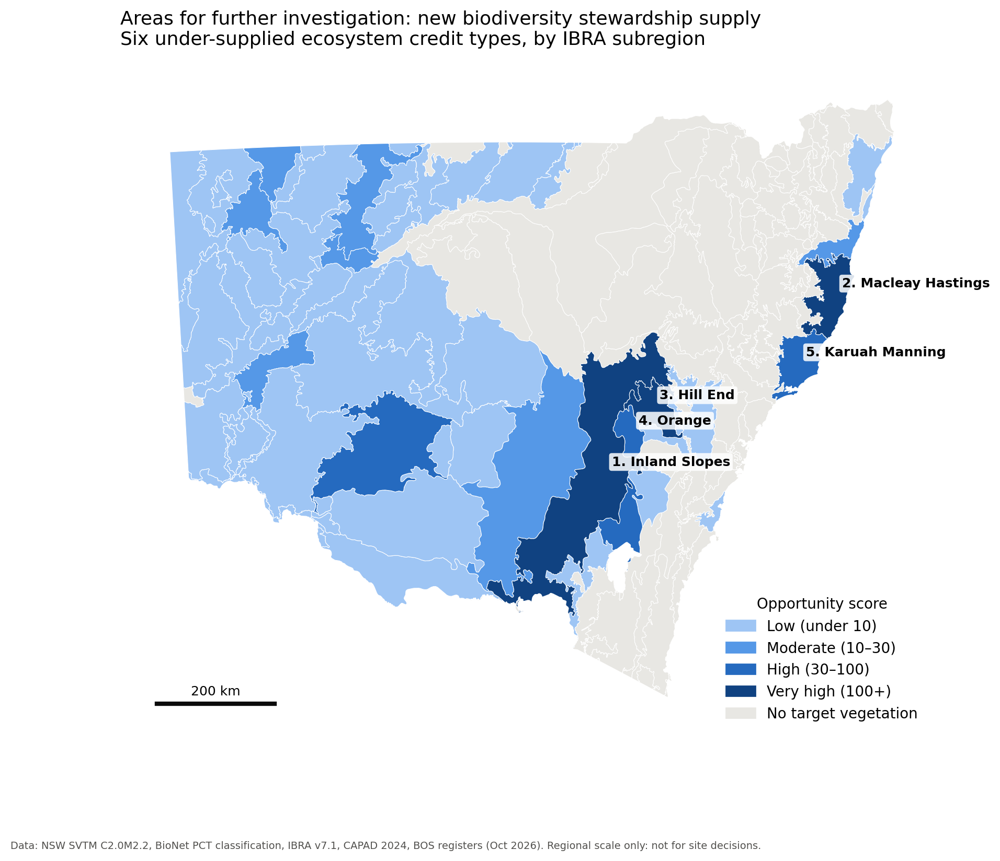

# Briefing note: Where to look for new biodiversity credit supply

| | |
|---|---|
| **Topic** | Remaining native vegetation for six under-supplied ecosystem credit types, NSW |
| **Prepared by** | Likitha Vankadoth (independent portfolio analysis, not an official NSW Government document) |
| **Date** | 11 October 2026 |
| **Purpose** | To identify IBRA subregions worth investigating for new Biodiversity Stewardship Agreements |

## Recommendations

1. **Note** the five subregions below as *areas for further investigation* for new credit supply:
   Inland Slopes, Macleay Hastings, Hill End, Orange and Karuah Manning.
2. **Prioritise** Southwest Ranges White Box Woodland (PCT 3406) around **Hill End and Orange**. It is
   89% cleared, has no credits available, and only 0.6% of what remains is protected.
3. **Field-validate** any shortlisted area before engaging landholders. The vegetation map is
   regional scale, and its accuracy at vegetation-type level is moderate.
4. **Ask DCCEEW to publish** a lookup between retired and current vegetation types (PCTs), so that
   demand for retired types can be matched to supply.

## Background

- The Biodiversity Offsets Scheme needs credits for the **same vegetation type** that a development
  clears (like-for-like).
- An earlier analysis of the BOS registers (Project 1, October 2026) found that 43 credit types have
  **zero credits available** but are still being retired by developers. This matches the NSW Audit
  Office (2022) and IPART (2026), which report widespread unmet demand.
- New supply depends on landholders with the **right remnant vegetation** entering stewardship
  agreements. This note shows where that vegetation remains.

## Key findings

| Credit type (PCT) | Remaining | Protected | % cleared | Retired/yr | Main subregions |
|---|---:|---:|---:|---:|---|
| 309 Black Cypress Pine – Red Stringybark | 7,424 ha | 39% | 15% | 507 | Inland Slopes (99%) |
| 290 Red Stringybark – Red Box | 42,852 ha | 23% | 67% | 289 | Inland Slopes (almost all) |
| 3406 Southwest Ranges White Box | 14,988 ha | **0.6%** | **89%** | 127 | Hill End, Orange (83%) |
| 4047 Northern Swamp Mahogany | 4,746 ha | 45% | 33% | 153 | Macleay Hastings, Karuah Manning (90%) |
| 24 Canegrass swamp | 790,654 ha | 10% | 20% | 155 | Bulloo, Lachlan, Paroo Overflow |

- **Supply is geographically concentrated.** The two most-demanded types (309 and 290) survive almost
  only in **Inland Slopes**, so a few landholders there could ease the shortage.
- **The ranking is robust.** The same top five subregions appear under four different weightings,
  including equal weights.
- **Biodiversity value is high.** Each top subregion has 66–211 threatened species recorded in BioNet.
  These counts are context only: they reflect survey effort.

## Considerations and limitations

- **Mapping accuracy.**
    - Reported vegetation-type accuracy is 57–76% by region (SVTM technical notes, 2022).
    - A Hunter field check found only 17% of labels correct (Hunter, 2016).
    - The map is not site scale.
- **Reclassified types.** PCT 1600 was retired in 2022, and PCT 1604 maps to only 5 ha. Their demand
  cannot be traced on the current map.
- **% cleared.** BioNet's official figures were used. The pre-clearing map gave very different results
  (for example, 6% cleared vs 67% for PCT 290).
- **Remnant is not supply.**
    - Tenure, condition and landholder interest are unknown.
    - Each site still needs a full Biodiversity Assessment Method survey.
- **Demand is a lower bound.** It is based on retirements, which miss unmet obligations.
- **Sensitive species.** Only counts per subregion are reported, with no locations, in line with the
  BioNet Sensitive Species Data Policy.

## Next steps

- Share the ranked list with the Biodiversity Conservation Trust for comment.
- Overlay cadastre and tenure for the top five subregions.
- Plan field validation for PCT 3406 around Hill End and Orange.

*Sources: DCCEEW SVTM C2.0M2.2; BioNet Vegetation Classification and Atlas; IBRA v7.1; CAPAD 2024; BOS
public registers (Oct 2026); Audit Office of NSW (2022); IPART (2026); Hunter (2016) Ecological
Management & Restoration 17(1).*
